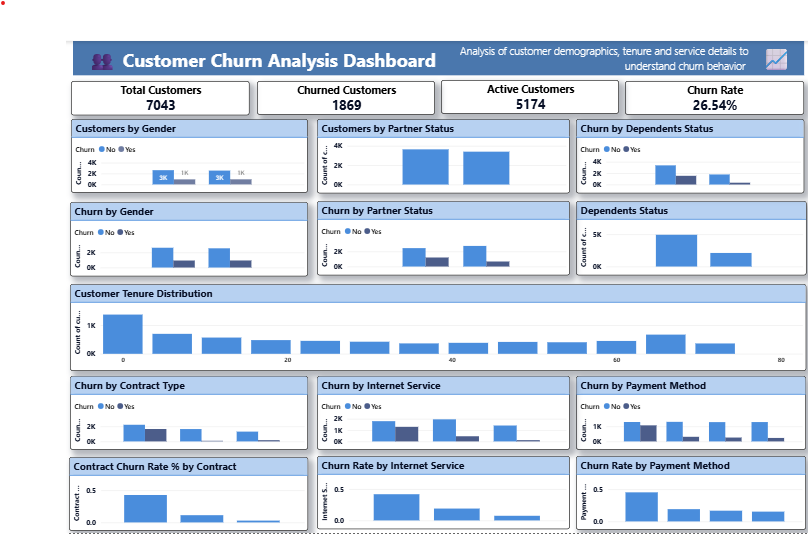

# Customer Churn Analysis using Power BI

## Project Overview
This project analyzes customer churn using Microsoft Power BI to understand customer retention patterns and identify factors associated with customers leaving a service. The dashboard presents key metrics and interactive visualizations to support data-driven decision-making.

## Project Objectives
- Analyze overall customer churn and retention.
- Monitor key performance indicators (KPIs).
- Explore churn patterns across customer demographics and tenure.
- Compare churn across contract types, payment methods, and internet services.
- Present findings through an interactive Power BI dashboard.

## Tools & Technologies
- **Power BI** — Interactive dashboard development and data visualization
- **Power Query** — Data cleaning and transformation
- **DAX** — KPI calculations and measures

## Key Performance Indicators
- Total Customers
- Churned Customers
- Customer Churn Rate

The dashboard reports a **26.54% churn rate**.

## Dashboard Preview

## Project Files
- `Saiket_Customer_Churn_Analysis.pbix` — Power BI dashboard file
- `Customer_Churn_Dashboard.png` — Dashboard preview
- `Project_Documentation.pdf` — Project documentation

## Key Analysis Areas
- Customer demographics
- Customer tenure
- Contract types
- Payment methods
- Internet services
- Customer churn patterns

## How to View the Project
1. Download the `.pbix` file from this repository.
2. Open it using Microsoft Power BI Desktop.
3. Explore the dashboard visuals and available filters.

